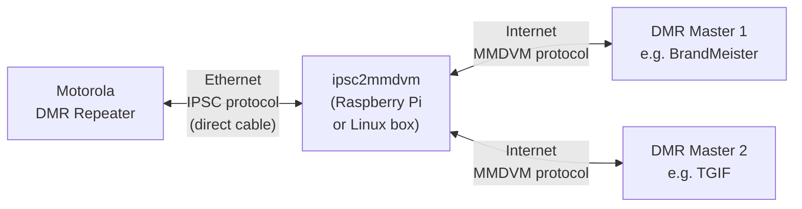

# ipsc2mmdvm

[](https://github.com/USA-RedDragon/ipsc2mmdvm/actions/workflows/release.yaml) [](https://github.com/USA-RedDragon/ipsc2mmdvm) [](https://github.com/USA-RedDragon/ipsc2mmdvm/blob/main/LICENSE) [](https://github.com/USA-RedDragon/ipsc2mmdvm/releases/) [](https://github.com/USA-RedDragon/ipsc2mmdvm/actions)

**Connect your Motorola IPSC repeater to MMDVM DMR Masters.**

ipsc2mmdvm is a protocol bridge that translates between Motorola's IP Site Connect (IPSC) protocol and the MMDVM Protocol. This lets your IPSC-only repeater talk to one or more DMR masters such as BrandMeister and TGIF simultaneously, with [DMRGateway](https://github.com/g4klx/DMRGateway)-compatible rewrite rules for routing talkgroups between networks.

## How It Works



Your repeater connects directly via Ethernet cable to the box running ipsc2mmdvm. The software acts as an IPSC master to the repeater and forwards voice and data traffic to and from one or more DMR masters over the internet. DMRGateway-style rewrite rules let you route specific talkgroups to specific masters.

## Requirements

- A **Motorola IPSC-capable DMR repeater**
- A **Raspberry Pi** (any model with Wi-Fi and an Ethernet port) or any **Linux box with a spare NIC**
- An **Ethernet cable** to connect the repeater directly to the Pi/Linux box
- **Internet access** on the Pi/Linux box (via Wi-Fi on a Raspberry Pi, or a second NIC on a Linux box)
- A **DMR Master** with a registered repeater ID to connect to (e.g. BrandMeister)

## Setup

### 1. Download ipsc2mmdvm

Download the latest release tarball for your platform from the [GitHub Releases](https://github.com/USA-RedDragon/ipsc2mmdvm/releases/latest) page. For a Raspberry Pi with 64-bit Raspberry Pi OS, grab the [`linux_arm64`](https://github.com/USA-RedDragon/ipsc2mmdvm/releases/latest) build. For 32-bit Raspberry Pi OS, use `linux_armv7` (or `linux_armv6` on a Pi 1 or Pi Zero). For desktop Linux, use [`linux_amd64`](https://github.com/USA-RedDragon/ipsc2mmdvm/releases/latest). Run `uname -m` if you are not sure: `aarch64` means `linux_arm64`, `armv7l` means `linux_armv7`, and `armv6l` means `linux_armv6`. Extract it and move the binary to your PATH:

```bash
tar xzf ipsc2mmdvm_*_linux_arm64.tar.gz
sudo mv ipsc2mmdvm /usr/local/bin/ipsc2mmdvm
```

### 2. Create the Config File

Download the example config (every setting at its default), add your `mmdvm` entries as in the full example below, then move it into place:

```bash
wget https://raw.githubusercontent.com/USA-RedDragon/ipsc2mmdvm/main/config.example.yaml -O ipsc2mmdvm.yaml
nano ipsc2mmdvm.yaml
sudo mv ipsc2mmdvm.yaml /etc/ipsc2mmdvm.yaml
```

Here is the full example config with comments:

```yaml
log-level: info

ipsc:
  interface: "eth0"       # The network interface connected to your repeater
  port: 50000             # UDP port the repeater will connect to
  ip: "10.10.250.1"       # IP address assigned to the interface (must match repeater's Gateway IP)
  subnet-mask: 24         # Subnet mask (24 = 255.255.255.0)
  auth:
    enabled: false        # Set to true if you configured an auth key in CPS
    key: ""               # Hex string, up to 40 characters (must match CPS)

metrics:
  enabled: false          # Enable Prometheus metrics endpoint
  address: ":9100"        # Address to serve metrics on (e.g. ":9100" for all interfaces)

mmdvm:
  - name: "BrandMeister"  # Friendly name for logging
    master-server: "3104.master.brandmeister.network:62031"  # BrandMeister master (see below)
    password: "passw0rd"  # Your BrandMeister hotspot password

    callsign: N0CALL      # Your callsign
    radio-id: 123456789   # Your registered repeater DMR ID

    # Frequencies in Hz:
    rx-freq: 429075000
    tx-freq: 424075000

    color-code: 7         # Must match your repeater's color code (0-15)

    # Optional, reported to BrandMeister:
    # latitude: 30.000000
    # longitude: -97.000000
    height: 3             # Antenna height in meters
    location: "My City, ST"
    # description: ""
    # url: ""

    # Routing rules (DMRGateway-compatible). A master with no rules gets no
    # traffic. These pass all group and private calls on both slots:
    pass-all-tg: [1, 2]
    pass-all-pc: [1, 2]

    # More specific rewrite rules, for example:
    # tg-rewrite:
    #   - from-slot: 1
    #     from-tg: 9
    #     to-slot: 1
    #     to-tg: 9
    #     range: 1

  # Add more masters for multi-network support:
  # - name: "TGIF"
  #   master-server: "tgif.network:62031"
  #   password: "secret"
  #   callsign: N0CALL
  #   radio-id: 123456789
  #   rx-freq: 429075000
  #   tx-freq: 424075000
  #   color-code: 7
  #   height: 3
  #   tg-rewrite:
  #     - from-slot: 2
  #       from-tg: 31665
  #       to-slot: 2
  #       to-tg: 31665
  #       range: 1
```

**Config notes:**

- **`ipsc.interface`** - The name of the network interface physically connected to your repeater. On a Raspberry Pi this is typically `eth0`. Run `ip link` to see your interface names.
- **`ipsc.ip`** - The IP address ipsc2mmdvm assigns to that interface. This becomes the "Master IP" in your repeater's CPS config, and also the gateway for the repeater. Pick any private IP (e.g. `10.10.250.1`).
- **`ipsc.port`** - The UDP port to listen on. The default `50000` works fine. Must match the "Master UDP Port" in CPS.
- **`mmdvm`** - A YAML array of DMR master connections. Each entry is a separate master. You can connect to as many masters as you like.
- **`mmdvm[].name`** - A friendly name for this network, used in log messages (e.g. `"BrandMeister"`, `"TGIF"`).
- **`mmdvm[].master-server`** - The master's host and port. For BrandMeister, find the master covering your region in the [BrandMeister Master Server List](https://brandmeister.network/?page=masters). The format is `host:port` (e.g. `3104.master.brandmeister.network:62031`). BrandMeister masters accept MMDVM connections on UDP port 62031.
- **`mmdvm[].pass-all-tg`, `mmdvm[].pass-all-pc`, and the rewrite lists** - Choose which traffic goes to this master. A master with no rules gets no traffic. See [Rewrite Rules](#rewrite-rules-per-mmdvm-entry).
- **`mmdvm[].password`** - Your hotspot security password, such as the one set in your BrandMeister self-care dashboard.
- **`mmdvm[].radio-id`** - Your repeater's DMR ID, registered at [radioid.net](https://radioid.net/).

### 3. Configure the Motorola Repeater (CPS)

Open your repeater's codeplug in the **Motorola Customer Programming Software (CPS)** and make the following changes:

> **Important:** You must enable **Expert Mode** first: go to **View → Expert** in the CPS menu bar.

#### Network Settings

|       Setting       |                              Value                               |
| ------------------- | ---------------------------------------------------------------- |
| **DHCP**            | **Disabled**                                                     |
| **Ethernet IP**     | A static IP on the same subnet as `ipsc.ip` (e.g. `10.10.250.2`) |
| **Gateway IP**      | The `ipsc.ip` value from your config (e.g. `10.10.250.1`)        |
| **Gateway Netmask** | Matching your `subnet-mask` (e.g. `255.255.255.0` for `/24`)     |

#### Link Establishment

|        Setting         |                                                              Value                                                              |
| ---------------------- | ------------------------------------------------------------------------------------------------------------------------------- |
| **Link Type**          | **Peer**                                                                                                                        |
| **Master IP**          | The `ipsc.ip` value from your config (e.g. `10.10.250.1`)                                                                       |
| **Master UDP Port**    | The `ipsc.port` value from your config (e.g. `50000`)                                                                           |
| **Authentication Key** | *(Optional)* Up to 40 hex characters. If set, enable `ipsc.auth.enabled` and put the same key in `ipsc.auth.key` in the config. |

Write the codeplug to the repeater.

### 4. Connect the Hardware

1. **Plug an Ethernet cable** directly from your repeater's Ethernet port to the Ethernet port on your Raspberry Pi (or spare NIC on your Linux box).
2. Make sure the Pi/Linux box has **internet access** through a different interface (Wi-Fi on a Pi, or a second NIC).

> **Note:** The Ethernet interface connected to the repeater is dedicated to ipsc2mmdvm. Do not use it for anything else, ipsc2mmdvm will assign it an IP address automatically.

### 5. Run ipsc2mmdvm

ipsc2mmdvm requires root privileges to configure the network interface. Give it the config file from step 2 with `--config`:

```bash
sudo ipsc2mmdvm --config /etc/ipsc2mmdvm.yaml
```

Without `--config`, ipsc2mmdvm reads `config.yaml` from the current directory.

On startup you should see the repeater register and traffic will begin flowing to BrandMeister.

### Running as a systemd Service

To have ipsc2mmdvm start automatically on boot, create a systemd service file:

```bash
sudo tee /etc/systemd/system/ipsc2mmdvm.service << 'EOF'
[Unit]
Description=ipsc2mmdvm - IPSC to MMDVM Bridge
After=network-online.target
Wants=network-online.target

[Service]
Type=simple
WorkingDirectory=/etc
ExecStart=/usr/local/bin/ipsc2mmdvm --config /etc/ipsc2mmdvm.yaml
Restart=on-failure
RestartSec=5

[Install]
WantedBy=multi-user.target
EOF
```

Then enable and start it:

```bash
sudo systemctl daemon-reload
sudo systemctl enable ipsc2mmdvm
sudo systemctl start ipsc2mmdvm
```

Check status and logs:

```bash
sudo systemctl status ipsc2mmdvm
sudo journalctl -u ipsc2mmdvm -f
```

## Runtime Behavior

- **Masters.** ipsc2mmdvm starts even if a master is down or its host name does not resolve yet. It tries to connect and log in again every keepalive interval (5 seconds) until the master answers. Only a malformed `master-server` value stops startup.
- **Traffic to a master.** ipsc2mmdvm sends voice and data to a master only while it is logged in to that master. Traffic for a master that is not logged in is dropped, as DMRGateway does.
- **Call hang.** After a voice call to the repeater ends on a timeslot, data and CSBK calls to the repeater on that timeslot wait for `ipsc.call-hang-hold` (2.5 s by default), and after a data call they wait for `ipsc.data-hang-hold` (1.2 s by default). Then they go out at their original pace. An XPR 8400 drops the data and CSBK calls it gets during its call hang of about 2 s after voice, and a data call that comes less than about 1 s after another. Voice never waits.
- **Bursts IPSC cannot carry.** Idle, unified single block, rate 1 and reserved bursts from a master, bursts that fail their FEC or CRC, and DMRD frame type 3 have no decoded form on IPSC. ipsc2mmdvm sends a rate 1 block to the repeater as a raw block (burst type `0x1F`) with its 196 information bits and its slot type, the form in which an XPR 8400 sends a burst it cannot decode. An XPR 8400 airs these blocks bit for bit on both slots. ipsc2mmdvm does not send the others to the repeater: it counts each one in `translator_undeliverable_total` and logs it. With `ipsc.raw-bursts` set to `all`, it sends each of them except frame type 3 as a raw block too. An XPR 8400 drops all of them, so use `all` only to test another repeater.
- **Repeater registration.** The repeater must register with ipsc2mmdvm (IPSC master register request, `0x90`) before it gets any traffic. ipsc2mmdvm ignores keepalives and voice from a repeater that has not registered. With IPSC authentication on, a keepalive with a valid HMAC registers the repeater, so a repeater comes back within one keepalive interval after ipsc2mmdvm restarts. A repeater that sends nothing for 120 seconds is removed and must register again.

### Repeater Limits

These limits were seen on an XPR 8400. ipsc2mmdvm cannot work around them.

- **Defined Short Data.** The repeater does not send a Defined Short Data header (data header format 13) over IPSC. It sends a copy of the last preamble CSBK in its place, then the rate 1/2 blocks. The SAP and format of the header are lost, so a receiver cannot decode these messages. ipsc2mmdvm sends the preambles and the blocks to the master as they came.
- **Rate 1 data.** The repeater does not relay rate 1 data correctly. It sends a clean rate 1 block as a data header packet with a meaningless payload, and a marginal one as a packet with the raw bits. ipsc2mmdvm sends both to the master as they came: the first as a data header that fails its CRC, the second as the rate 1 burst. ipsc2mmdvm sends rate 1 data to the repeater as raw blocks, which the repeater airs bit for bit.
- **Bursts the repeater drops.** The repeater drops these bursts from the network with no RF and no side effects: data blocks with no data header before them (seen with rate 1/2 blocks), an MBC whose last block does not come, and any terminator data LC (TD_LC). ipsc2mmdvm still sends them to the repeater in their usual form. The repeater also drops every raw block but rate 1 (see `ipsc.raw-bursts`).

## Configuration Reference

Settings can be given in the config file, as environment variables, or as command-line flags.

<!-- configulator:begin -->

| Key                                | Type            | Default       | Environment           | Flag                    | Description                                                                                                |
|------------------------------------|-----------------|---------------|-----------------------|-------------------------|------------------------------------------------------------------------------------------------------------|
| `log-level`                        | string          | `info`        | `LOG_LEVEL`           | `--log-level`           | Logging level for the application. One of debug, info, warn, or error                                      |
| `metrics.enabled`                  | boolean         |               | `METRICS_ENABLED`     | `--metrics.enabled`     | Whether to enable Prometheus metrics endpoint                                                              |
| `metrics.address`                  | string          | `:9100`       | `METRICS_ADDRESS`     | `--metrics.address`     | Address to serve Prometheus metrics on                                                                     |
| `mmdvm`                            | list of objects |               | —                     | —                       | Configuration for MMDVM clients (multiple DMR masters)                                                     |
| `mmdvm[].name`                     | string          |               | —                     | —                       | Name for this MMDVM network (used in logging)                                                              |
| `mmdvm[].callsign`                 | string          |               | —                     | —                       | Callsign to use for the MMDVM connection                                                                   |
| `mmdvm[].radio-id`                 | integer         |               | —                     | —                       | Radio ID for the MMDVM connection                                                                          |
| `mmdvm[].rx-freq`                  | integer         |               | —                     | —                       | Receive frequency in Hz for the MMDVM connection                                                           |
| `mmdvm[].tx-freq`                  | integer         |               | —                     | —                       | Transmit frequency in Hz for the MMDVM connection                                                          |
| `mmdvm[].tx-power`                 | integer         |               | —                     | —                       | Transmit power in dBm for the MMDVM connection                                                             |
| `mmdvm[].color-code`               | integer         |               | —                     | —                       | DMR color code for the MMDVM connection                                                                    |
| `mmdvm[].latitude`                 | number          |               | —                     | —                       | Latitude with north as positive [-90,+90] for the MMDVM connection                                         |
| `mmdvm[].longitude`                | number          |               | —                     | —                       | Longitude with east as positive [-180+,180] for the MMDVM connection                                       |
| `mmdvm[].height`                   | integer         |               | —                     | —                       | Height in meters for the MMDVM connection                                                                  |
| `mmdvm[].location`                 | string          |               | —                     | —                       | Location for the MMDVM connection                                                                          |
| `mmdvm[].description`              | string          |               | —                     | —                       | Description for the MMDVM connection                                                                       |
| `mmdvm[].url`                      | string          |               | —                     | —                       | URL for the MMDVM connection                                                                               |
| `mmdvm[].slots`                    | integer         | `3`           | —                     | —                       | Active timeslots bitmask (1=TS1, 2=TS2, 3=both)                                                            |
| `mmdvm[].master-server`            | string          |               | —                     | —                       | Master server for the MMDVM connection                                                                     |
| `mmdvm[].password`                 | string          |               | —                     | —                       | Password for the MMDVM connection (secret)                                                                 |
| `mmdvm[].tg-rewrite`               | list of objects |               | —                     | —                       | Talkgroup rewrite rules                                                                                    |
| `mmdvm[].tg-rewrite[].from-slot`   | integer         |               | —                     | —                       | Source timeslot (1 or 2)                                                                                   |
| `mmdvm[].tg-rewrite[].from-tg`     | integer         |               | —                     | —                       | Source talkgroup start                                                                                     |
| `mmdvm[].tg-rewrite[].to-slot`     | integer         |               | —                     | —                       | Destination timeslot (1 or 2)                                                                              |
| `mmdvm[].tg-rewrite[].to-tg`       | integer         |               | —                     | —                       | Destination talkgroup start                                                                                |
| `mmdvm[].tg-rewrite[].range`       | integer         | `1`           | —                     | —                       | Number of contiguous TGs to map                                                                            |
| `mmdvm[].pc-rewrite`               | list of objects |               | —                     | —                       | Private call rewrite rules                                                                                 |
| `mmdvm[].pc-rewrite[].from-slot`   | integer         |               | —                     | —                       | Source timeslot (1 or 2)                                                                                   |
| `mmdvm[].pc-rewrite[].from-id`     | integer         |               | —                     | —                       | Source private call ID start                                                                               |
| `mmdvm[].pc-rewrite[].to-slot`     | integer         |               | —                     | —                       | Destination timeslot (1 or 2)                                                                              |
| `mmdvm[].pc-rewrite[].to-id`       | integer         |               | —                     | —                       | Destination private call ID start                                                                          |
| `mmdvm[].pc-rewrite[].range`       | integer         | `1`           | —                     | —                       | Number of contiguous IDs to map                                                                            |
| `mmdvm[].type-rewrite`             | list of objects |               | —                     | —                       | Type rewrite rules (group TG to private call)                                                              |
| `mmdvm[].type-rewrite[].from-slot` | integer         |               | —                     | —                       | Source timeslot (1 or 2)                                                                                   |
| `mmdvm[].type-rewrite[].from-tg`   | integer         |               | —                     | —                       | Source talkgroup start                                                                                     |
| `mmdvm[].type-rewrite[].to-slot`   | integer         |               | —                     | —                       | Destination timeslot (1 or 2)                                                                              |
| `mmdvm[].type-rewrite[].to-id`     | integer         |               | —                     | —                       | Destination private call ID start                                                                          |
| `mmdvm[].type-rewrite[].range`     | integer         | `1`           | —                     | —                       | Number of contiguous entries to map                                                                        |
| `mmdvm[].src-rewrite`              | list of objects |               | —                     | —                       | Source rewrite rules (private call by source to group TG)                                                  |
| `mmdvm[].src-rewrite[].from-slot`  | integer         |               | —                     | —                       | Source timeslot (1 or 2)                                                                                   |
| `mmdvm[].src-rewrite[].from-id`    | integer         |               | —                     | —                       | Source ID start                                                                                            |
| `mmdvm[].src-rewrite[].to-slot`    | integer         |               | —                     | —                       | Destination timeslot (1 or 2)                                                                              |
| `mmdvm[].src-rewrite[].to-tg`      | integer         |               | —                     | —                       | Destination talkgroup for the converted group call                                                         |
| `mmdvm[].src-rewrite[].range`      | integer         | `1`           | —                     | —                       | Number of contiguous source IDs to match                                                                   |
| `mmdvm[].pass-all-pc`              | list of integer |               | —                     | —                       | Timeslots on which all private calls pass through unchanged (e.g. [1, 2])                                  |
| `mmdvm[].pass-all-tg`              | list of integer |               | —                     | —                       | Timeslots on which all group calls pass through unchanged (e.g. [1, 2])                                    |
| `ipsc.interface`                   | string          |               | `IPSC_INTERFACE`      | `--ipsc.interface`      | Interface to listen for IPSC packets on                                                                    |
| `ipsc.port`                        | integer         | `50000`       | `IPSC_PORT`           | `--ipsc.port`           | Port to listen for IPSC packets on                                                                         |
| `ipsc.ip`                          | string          | `10.10.250.1` | `IPSC_IP`             | `--ipsc.ip`             | IP address to listen for IPSC packets on                                                                   |
| `ipsc.subnet-mask`                 | integer         | `24`          | `IPSC_SUBNET_MASK`    | `--ipsc.subnet-mask`    | Subnet mask for the virtual network interface created for IPSC packets                                     |
| `ipsc.auth.enabled`                | boolean         |               | `IPSC_AUTH_ENABLED`   | `--ipsc.auth.enabled`   | Whether to require authentication for IPSC clients                                                         |
| `ipsc.auth.key`                    | string          |               | `IPSC_AUTH_KEY`       | `--ipsc.auth.key`       | Authentication key for IPSC clients. Required if auth is enabled (secret)                                  |
| `ipsc.call-hang-hold`              | string          | `2.5s`        | `IPSC_CALL_HANG_HOLD` | `--ipsc.call-hang-hold` | Wait for data and CSBK calls to IPSC after a voice call on a slot; 0 is off                                |
| `ipsc.data-hang-hold`              | string          | `1.2s`        | `IPSC_DATA_HANG_HOLD` | `--ipsc.data-hang-hold` | Wait for data and CSBK calls to IPSC after a data call on a slot; 0 is off                                 |
| `ipsc.raw-bursts`                  | string          | `rate1`       | `IPSC_RAW_BURSTS`     | `--ipsc.raw-bursts`     | Bursts IPSC cannot carry decoded to send as raw 0x1F blocks: rate1 (the only kind an XPR 8400 airs) or all |

<!-- configulator:end -->

### Rewrite Rules (per MMDVM entry)

Rewrite rules control how DMR traffic is routed between the repeater and each master. They follow the same semantics as [DMRGateway](https://github.com/g4klx/DMRGateway): the first matching rule wins. A master only gets the traffic that its rules match. If a master has no rules, no traffic passes to or from it. To pass everything on a slot without changes, use `pass-all-tg` and `pass-all-pc`.

For traffic from the repeater, ipsc2mmdvm checks the rewrite rules of every master first, then the pass-all rules. So a specific rule on one master wins over a pass-all rule on another.

Each MMDVM entry can have these rule lists (fields are in the table above):

- `tg-rewrite`: remap group talkgroup calls
- `pc-rewrite`: remap private calls by destination ID
- `type-rewrite`: convert group TG calls to private calls
- `src-rewrite`: convert private calls from a range of source IDs into group calls to one talkgroup (`to-tg`), keeping the source ID

`src-rewrite` changed meaning. It used to rewrite the source ID of any call from the source range to `to-id`. It now matches only private calls from the source range and turns them into group calls to `to-tg`, like DMRGateway `SrcRewrite`. If your configuration has a `src-rewrite` rule with `to-id`, rename the key to `to-tg` and make sure the new behavior is what you want.
